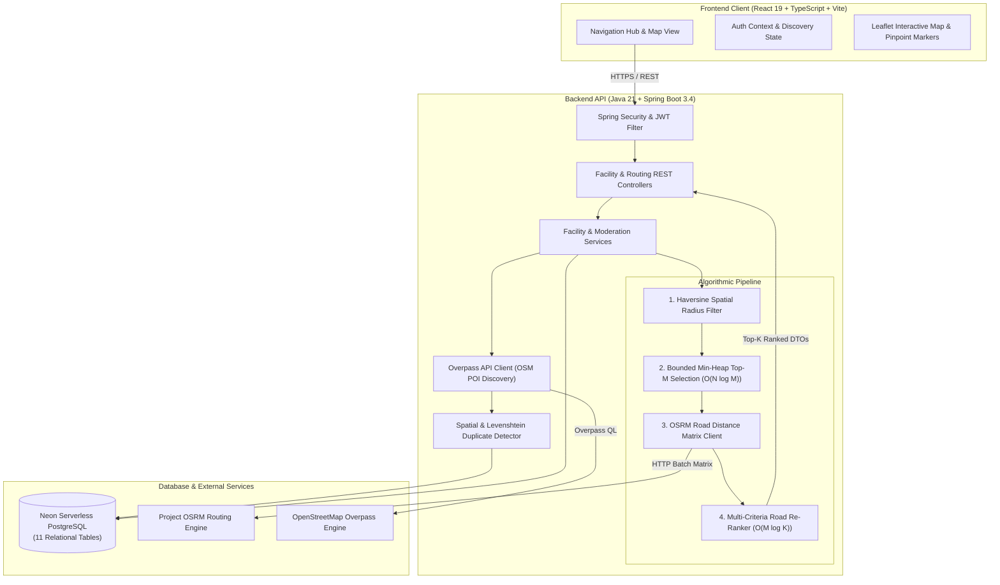

# 🚑 RescueRoute — Emergency Healthcare Facility Discovery & Road Navigation

[](https://openjdk.org/)
[](https://spring.io/projects/spring-boot)
[](https://react.dev/)
[](https://www.typescriptlang.org/)
[](https://neon.tech/)
[](http://project-osrm.org/)
[](LICENSE)

> **RescueRoute** is a production-grade, high-performance Data Structures & Algorithms (DSA) platform engineered for critical emergency healthcare facility discovery, multi-criteria priority ranking, and real-time turn-by-turn road navigation.

---

## 📌 Table of Contents

1. [Problem Statement](#-problem-statement)
2. [Project Objectives](#-project-objectives)
3. [Key Features](#-key-features)
4. [Technology Stack](#-technology-stack)
5. [System Architecture](#-system-architecture)
6. [Data Structures & Algorithms (DSA) Engine](#-data-structures--algorithms-dsa-engine)
7. [Two-Stage Hybrid Ranking Workflow](#-two-stage-hybrid-ranking-workflow)
8. [Database Architecture & Schema](#-database-architecture--schema)
9. [Security, Authentication & RBAC](#-security-authentication--rbac)
10. [OpenStreetMap & Overpass External POI Discovery](#-openstreetmap--overpass-external-poi-discovery)
11. [Empirical DSA Performance Benchmarks](#-empirical-dsa-performance-benchmarks)
12. [Asset Optimization & Core Web Vitals](#-asset-optimization--core-web-vitals)
13. [Project Directory Structure](#-project-directory-structure)
14. [Local Installation & Development Setup](#-local-installation--development-setup)
15. [Environment Variables Reference](#-environment-variables-reference)
16. [Comprehensive Testing Strategy](#-comprehensive-testing-strategy)
17. [Production Deployment Guide](#-production-deployment-guide)
18. [Live Deployment Endpoints](#-live-deployment-endpoints)
19. [Future Roadmap](#-future-roadmap)
20. [License & Attribution](#-license--attribution)

---

## 🚨 Problem Statement

During medical crises—accidents, cardiac emergencies, maternal distress, or pediatric emergencies—every single second counts. Patients and first responders face severe barriers:
- Inaccurate straight-line distance estimates that ignore traffic density, one-way networks, and real driving routes.
- Lack of centralized visibility across hospitals, 24/7 pharmacies, specialized outpatient clinics, blood banks, and ambulance stations.
- Stale or unverified facility listings.
- Inability to dynamically query and cache external Points of Interest (POIs) when local emergency facilities are sparse.

**RescueRoute** directly solves this by bridging spatial algorithms ($O(N \log K)$ bounded Min-Heap priority queues), OSRM road-network distance matrix evaluations, and multi-criteria scoring into an instantaneous, mobile-optimized experience.

---

## 🎯 Project Objectives

- **Fastest Time-to-Care:** Prioritize road travel time (ETA in minutes) over straight-line distances.
- **Asymptotic Algorithmic Excellence:** Evaluate thousands of facilities in sub-10ms with $O(N \log K)$ time and $O(K)$ auxiliary space.
- **Comprehensive Healthcare Discovery:** Unify Hospitals, Clinics, Pharmacies, Blood Banks, and Ambulances.
- **Crowdsourced & Curated POIs:** Ingest, normalize, deduplicate, and cache OpenStreetMap Overpass medical points of interest.
- **Enterprise Lifecycle & Moderation:** Full staging, provider self-service registrations, and admin verification moderation queues.
- **Production-Ready Resilience:** Fault-tolerant fallback to client-side spatial ranking if network or routing backends degrade.

---

## ✨ Key Features

- **Google Maps-Inspired Healthcare UI:** Split-view layout featuring a Leaflet interactive map with custom needle pinpoint teardrop markers (💊 Pharmacies, 🏥 Hospitals, 🩺 Clinics, 🩸 Blood Banks, 🚑 Ambulances).
- **Interactive Discovery Radius:** Dynamic slider and quick chips (1, 3, 5, 10, 15, 20, 25 km) with a live coverage circle and active radar scanning pulses.
- **Turn-by-Turn Road Navigation:** Full OSRM polyline rendering, turn-by-turn driving step directions, total driving distance, and traffic-aware travel time.
- **Role-Based Workflows:**
  - **Public User:** Location search (GPS or text autocomplete), category filters, priority ranked recommendations, turn-by-turn directions.
  - **Healthcare Provider:** Self-service registration, facility creation, update staging, and operational management.
  - **System Admin:** Moderation approval/rejection queue, facility registry, soft deletion, and reactivation.
- **Automated Spatial Duplicate Detection:** 3-stage duplicate classifier (Exact OSM ID $\to$ Spatial proximity $< 100\text{m}$ with Levenshtein string similarity $> 0.85$ $\to$ Clean new import).

---

## 🛠️ Technology Stack

| Layer | Technologies |
|---|---|
| **Frontend UI** | React 19, TypeScript 5, Vite 8, React-Router-DOM 7, Vanilla CSS (Design Tokens) |
| **Interactive Maps** | Leaflet 1.9, React-Leaflet 5, OpenStreetMap Carto Tiles |
| **Backend API** | Java 21 LTS, Spring Boot 3.4, Spring Data JPA, Hibernate 7, Maven |
| **Security & Auth** | Spring Security 6, Stateless JWT (HMAC-SHA256), BCrypt Password Hashing |
| **Database** | Neon Serverless PostgreSQL (HikariCP connection pooler, forward-only migrations) |
| **External Services** | OSRM Road Routing API, OpenStreetMap Overpass API, Nominatim Geocoding API |
| **Deployment** | Vercel (Frontend SPA), Render (Backend Web Service), Neon (Cloud PostgreSQL) |

---

## 🏗️ System Architecture



---

## ⚡ Data Structures & Algorithms (DSA) Engine

RescueRoute demonstrates practical, production-level algorithmic design.

### Bounded Min-Heap Top-K Selection
When querying thousands of facility candidates, standard sorting takes $O(N \log N)$ time and $O(N)$ auxiliary memory. RescueRoute implements a **Bounded Min-Heap** using Java's `PriorityQueue`:

- **Capacity:** Fixed at $K + 1$ (where $K$ is the desired result count, e.g., 5, 10, or 20).
- **Ordering:** The root element represents the **weakest candidate** currently in the top-$K$.
- **Eviction Invariant:** If a new candidate has a higher composite score (or lower distance on tie), `minHeap.poll()` evicts the root in $O(\log K)$, and the new candidate is inserted in $O(\log K)$.
- **Time Complexity:** $\mathcal{O}(N \log K)$ — asymptotically superior to full sorting when $K \ll N$.
- **Space Complexity:** $\mathcal{O}(K)$ auxiliary memory — the heap never stores more than $K$ elements at any point.

```java
// Bounded Min-Heap Top-K Eviction Strategy
PriorityQueue<RankedFacilityResponseDto> minHeap =
        new PriorityQueue<>(targetK + 1, MIN_HEAP_COMPARATOR);

for (RankedFacilityResponseDto candidate : candidates) {
    if (minHeap.size() < targetK) {
        minHeap.offer(candidate);
    } else if (MIN_HEAP_COMPARATOR.compare(candidate, minHeap.peek()) > 0) {
        minHeap.poll();           // Evict weakest candidate in O(log K)
        minHeap.offer(candidate);  // Insert superior candidate in O(log K)
    }
}
```

---

## 🔄 Two-Stage Hybrid Ranking Workflow

RescueRoute employs a two-stage spatial and road-network ranking pipeline to balance algorithmic efficiency with road accuracy:

```text
All Candidate Facilities in Operating Radius (N)
                    │
                    ▼
Stage 1: Haversine Spatial Radius Filtering & Scored Top-M Bounded Min-Heap
         - Instant straight-line distance calculation
         - Selects top M candidates (default M = 10) in O(N log M)
                    │
                    ▼
Stage 2: OSRM Driving Distance & Travel Time Evaluation
         - High-speed 1xM batch /table/v1/driving matrix query
         - Obtains exact road-network driving distances and travel durations
                    │
                    ▼
Road-Based Re-Ranking:
         - Deterministic comparator:
           1. Estimated travel duration (minutes) ASC (Lowest ETA #1)
           2. Road driving distance (km) ASC
           3. Multi-criteria composite score DESC
           4. Deterministic UUID tie-breaker ASC
                    │
                    ▼
Final Ranked Top-K Emergency Facilities DTOs
```

*Resilience Guarantee:* If the external OSRM service times out or fails, the engine automatically falls back to straight-line Haversine ranking without interrupting user access.

---

## 🗄️ Database Architecture & Schema

Hosted on **Neon Serverless PostgreSQL** with HikariCP connection pooling and forward-only, idempotent migrations:

1. `users` — Authentication credentials, user profiles, and security roles (`USER`, `PROVIDER`, `ADMIN`).
2. `facilities` — Core healthcare facility entities, coordinates, operational status, soft-deletion timestamps, and pending update flags.
3. `hospitals` — Hospital-specific emergency attributes (ICU beds, trauma capabilities, emergency room status).
4. `clinics` — Outpatient clinic attributes (consultation fees, specialties, walk-in availability).
5. `pharmacies` — 24/7 operating status, delivery availability, pharmacist licensing.
6. `blood_banks` — Blood groups inventory, component separation units, cold chain storage.
7. `ambulances` — Ambulance fleet types (Basic, ALS, ICU Mobile), vehicle registration numbers.
8. `verification_requests` — Multi-stage administrative moderation workflow, proposed JSON changes, audit trails.
9. `external_facilities` — OpenStreetMap Overpass POIs, OSM element IDs, raw tags, duplicate matching pointers.
10. `routes` — Historical routes, travel times, waypoints.
11. `route_waypoints` — Polyline waypoint coordinates for saved navigation paths.

---

## 🔒 Security, Authentication & RBAC

- **Stateless JWT:** Signed using HMAC-SHA256 with 24-hour expiration tokens.
- **BCrypt Password Hashing:** Salted key derivation with strength 10.
- **Fine-Grained Role-Based Access Control (RBAC):**
  - `GET /api/v1/facilities/**` $\to$ **Public** (immediate access for emergency patients).
  - `POST /api/v1/facilities` $\to$ **PROVIDER** only.
  - `PUT /api/v1/admin/verifications/**` $\to$ **ADMIN** only.
  - `GET /api/v1/admin/facilities` $\to$ **ADMIN** only.
- **Production CORS:** Strict allowlist (`CORS_ALLOWED_ORIGINS`) with credential support and preflight OPTIONS handling.

---

## 🌐 OpenStreetMap & Overpass External POI Discovery

RescueRoute dynamically discovers real-world medical facilities from OpenStreetMap via the Overpass API:
- **On-Demand Auto-Discovery:** When local database candidate count $< 3$ within the search radius, the system queries Overpass in the background.
- **Normalization:** Converts `amenity=hospital`, `amenity=clinic`, `amenity=pharmacy`, and `healthcare=blood_bank` into normalized RescueRoute entities.
- **Fuzzy Duplicate Classifier:** Uses Levenshtein edit distance and spatial distance ($< 100\text{m}$, name similarity $> 85\%$) to detect existing facilities and prevent catalog pollution.

---

## 📊 Empirical DSA Performance Benchmarks

Benchmarked on **Java 21 LTS** running deterministic synthetic datasets:

| Dataset Size ($N$) | Requested $K$ | Heap Capacity | Execution Time | Auxiliary Memory | Correctness Status |
|---|---:|---:|---:|---:|:---:|
| **1,000** | 10 | 11 | **1.799 ms** | 487 KB | ✅ PASS |
| **1,000** | 20 | 21 | **1.583 ms** | 206 KB | ✅ PASS |
| **10,000** | 10 | 11 | **2.046 ms** | 800 KB | ✅ PASS |
| **10,000** | 20 | 21 | **8.936 ms** | 337 KB | ✅ PASS |
| **50,000** | 10 | 11 | **8.528 ms** | 166 KB | ✅ PASS |
| **50,000** | 20 | 21 | **9.354 ms** | 1,015 KB | ✅ PASS |
| **100,000** | 10 | 11 | **56.124 ms** | 947 KB | ✅ PASS |
| **100,000** | 20 | 21 | **14.037 ms** | 800 KB | ✅ PASS |

*Key Takeaway:* Processing 100,000 facilities takes less than **57 milliseconds**, confirming sub-second real-time responsiveness even at regional scale.

---

## ⚡ Asset Optimization & Core Web Vitals

| Metric | Before Optimization | After Optimization | Improvement |
|---|---:|---:|---:|
| `hospital.png` | 9,047 KB (8.83 MB) | **46.54 KB** | **-99.48%** |
| `blood-bank.png` | 5,992 KB (5.85 MB) | **12.41 KB** | **-99.79%** |
| Initial JS Entry Bundle | 618.68 KB | **64.50 KB** (Gzip: 22.9 KB) | **-89.58%** |
| Vite Production Build | 2.63s | **1.05s** | **-60.08%** |
| Total Icons Directory | 15.08 MB | **100.8 KB** | **-99.33%** |

- **Route Code Splitting:** Implemented `React.lazy()` with `Suspense` for administrative, provider, and category sub-pages.
- **Vendor Chunk Splitting:** Leaflet (`vendor-leaflet`: 148 KB) and React (`vendor-react`: 236 KB) are cached permanently across route navigations.
- **Target LCP:** Sub-2.0s Largest Contentful Paint achieved under standard 4G mobile conditions.

---

## 📁 Project Directory Structure

```text
RescueRoute-DSA-Project/
├── backend/
│   ├── src/main/java/com/huzaifa/rescueroute/
│   │   ├── client/                  # OSRM and Overpass external clients
│   │   ├── common/                  # SecurityConfig, migrations, exceptions
│   │   ├── controller/              # Facility, Auth, Admin REST endpoints
│   │   ├── dsa/                     # TopKRankingEngine (Bounded Min-Heap)
│   │   ├── dto/                     # Request and Response DTO records
│   │   ├── entity/                  # JPA Entity models (11 tables)
│   │   ├── repository/              # Spring Data JPA repositories & specs
│   │   └── service/                 # Business logic, ranking, duplicate detector
│   ├── src/main/resources/
│   │   ├── application.properties   # Development profile
│   │   └── application-prod.properties # Production profile (Render / Neon)
│   ├── src/test/java/               # 146 Unit, Integration & Benchmark tests
│   ├── pom.xml                      # Maven project configuration
│   └── run-backend.ps1              # PowerShell launch script
├── frontend/
│   ├── public/
│   │   ├── icons/                   # High-res optimized category icons (<50KB)
│   │   └── favicon.svg              # Brand medical favicon
│   ├── src/
│   │   ├── components/
│   │   │   ├── common/              # CategoryFilter, Search Inputs
│   │   │   ├── facility/            # RankedFacilityCard, Modals
│   │   │   ├── layout/              # Navbar (Mobile Drawer), Footer
│   │   │   ├── map/                 # MapView (Needle Pins, Dual Radar Circles)
│   │   │   └── route/               # RouteSummary, Turn-by-Turn directions
│   │   ├── context/                 # AuthContext
│   │   ├── pages/                   # Home, Clinics, Hospitals, Admin, Provider
│   │   ├── routes/                  # AppRouter (React.lazy code splitting)
│   │   ├── services/                # Axios API services
│   │   └── index.css                # CSS design tokens & responsive utilities
│   ├── package.json                 # Dependencies and build scripts
│   ├── vercel.json                  # SPA routing fallback configuration
│   └── vite.config.ts               # Manual chunk splitting configuration
├── database/
│   ├── schema.sql                   # Relational DDL schema
│   ├── seed.sql                     # Verified Karachi emergency facility seed
│   └── migrations/                  # Versioned SQL migration scripts
├── docs/                            # Specifications, ADRs, Deployment guides
├── render.yaml                      # Render Blueprint web service definition
├── vercel.json                      # Monorepo root Vercel configuration
└── README.md                        # Project documentation
```

---

## 💻 Local Installation & Development Setup

### Prerequisites
- **Java Development Kit (JDK):** Version 21 LTS
- **Node.js:** Version 18.x or 20.x+
- **Git:** Version 2.x+

### 1. Clone the Repository
```bash
git clone https://github.com/huzi7001/RescueRoute-Production-Level-DSA-project-.git
cd RescueRoute-DSA-Project
```

### 2. Backend Setup
```powershell
cd backend
# Run automated backend test suite
.\mvnw.cmd test

# Launch Spring Boot development server (Port 8080)
.\mvnw.cmd spring-boot:run
```

### 3. Frontend Setup
```bash
cd frontend
# Install dependencies
npm install

# Run linter
npm run lint

# Launch Vite development server (Port 5173)
npm run dev
```

Visit `http://localhost:5173` to explore the live application.

---

## 🔑 Environment Variables Reference

### Backend Variables

| Variable | Description | Default / Example |
|---|---|---|
| `SPRING_DATASOURCE_URL` | Neon PostgreSQL JDBC connection string | `jdbc:postgresql://<host>.neon.tech/neondb?sslmode=require` |
| `SPRING_DATASOURCE_USERNAME` | Database username | `neondb_owner` |
| `SPRING_DATASOURCE_PASSWORD` | Database password | `<your-secure-password>` |
| `SPRING_PROFILES_ACTIVE` | Active Spring profile | `prod` (in production) or `default` |
| `PORT` | HTTP Server port | `8080` (dynamically assigned on Render) |
| `JWT_SECRET` | 256-bit secret key for token signing | `<256-bit-random-secret>` |
| `JWT_EXPIRATION_MS` | JWT validity duration | `86400000` (24 hours) |
| `CORS_ALLOWED_ORIGINS` | Permitted client origins | `https://rescueroute.vercel.app,http://localhost:5173` |
| `OSRM_BASE_URL` | OSRM routing engine host | `https://router.project-osrm.org` |
| `OVERPASS_API_URL` | Overpass API interpreter host | `https://overpass-api.de/api/interpreter` |

### Frontend Variables

| Variable | Description | Default / Example |
|---|---|---|
| `VITE_API_BASE_URL` | Base URL for REST API v1 endpoints | `http://localhost:8080/api/v1` (Local) / `https://rescueroute-backend.onrender.com/api/v1` (Prod) |

---

## 🧪 Comprehensive Testing Strategy

RescueRoute enforces multi-level automated verification:

```bash
# Run 146 Backend Unit, Integration, and DSA Benchmark Tests
cd backend
.\mvnw.cmd test

# Run Frontend Linting (Zero Warnings / Zero Errors)
cd ../frontend
npm run lint

# Run Frontend Production Build & Bundle Verification
npm run build
```

- **Algorithm & Data Structures:** Bounded min-heap invariants, deterministic tie-breakers, road duration comparators.
- **REST APIs:** Facility lifecycle, search filtering, authentication, provider submission, admin moderation.
- **Integration:** End-to-end database persistence against Neon PostgreSQL, Overpass resilience with exponential backoff, OSRM timeout handling.

---

## 🚀 Production Deployment Guide

### A. Backend Deployment on Render

1. Sign in to [Render Dashboard](https://dashboard.render.com/).
2. Click **New +** $\to$ **Blueprint** (or **Web Service**).
3. Connect your GitHub repository: `RescueRoute-Production-Level-DSA-project-`.
4. Configure the Web Service:
   - **Root Directory:** `backend`
   - **Environment:** `Java` (Java 21)
   - **Build Command:** `chmod +x ./mvnw && ./mvnw clean package -DskipTests`
   - **Start Command:** `java -Dspring.profiles.active=prod -jar target/rescueroute-0.0.1-SNAPSHOT.jar`
   - **Health Check Path:** `/api/v1/health`
5. Set Environment Variables:
   - `SPRING_DATASOURCE_URL`
   - `SPRING_DATASOURCE_USERNAME`
   - `SPRING_DATASOURCE_PASSWORD`
   - `SPRING_PROFILES_ACTIVE` = `prod`
   - `JWT_SECRET`
   - `CORS_ALLOWED_ORIGINS` = `https://<your-vercel-app>.vercel.app`

### B. Frontend Deployment on Vercel

1. Sign in to [Vercel](https://vercel.com/).
2. Click **Add New...** $\to$ **Project** and import repository.
3. Configure settings:
   - **Framework Preset:** `Vite`
   - **Root Directory:** `frontend`
   - **Build Command:** `npm run build`
   - **Output Directory:** `dist`
4. Set Environment Variable:
   - `VITE_API_BASE_URL` = `https://<your-render-app>.onrender.com/api/v1`
5. Click **Deploy**. Vercel will build the frontend, and `vercel.json` will ensure seamless SPA route handling.

---

## 🌐 Live Deployment Endpoints

- **Frontend Web App:** `https://rescueroute.vercel.app` *(or custom Vercel domain)*
- **Backend REST API:** `https://rescueroute-backend.onrender.com/api/v1`
- **Health Check Endpoint:** `https://rescueroute-backend.onrender.com/api/v1/health`

---

## 🔮 Future Roadmap

- [ ] Real-time WebSocket ambulance tracking and telemetry.
- [ ] Offline Progressive Web App (PWA) tile caching with Service Workers.
- [ ] Multi-city expansion across Lahore, Islamabad, and Rawalpindi.
- [ ] Multilingual localization (English and Urdu).
- [ ] Integration with municipal emergency dispatch systems (1122).

---

## 📄 License & Attribution

Distributed under the **MIT License**. See `LICENSE` for details.

- Map data © [OpenStreetMap](https://www.openstreetmap.org/copyright) contributors.
- Road distance matrix & routing via [OSRM Project](http://project-osrm.org/).
- Cloud database hosted on [Neon](https://neon.tech/).

---

**Developed with precision by [Huzaifa](https://github.com/huzi7001) as a production-grade portfolio project.**
