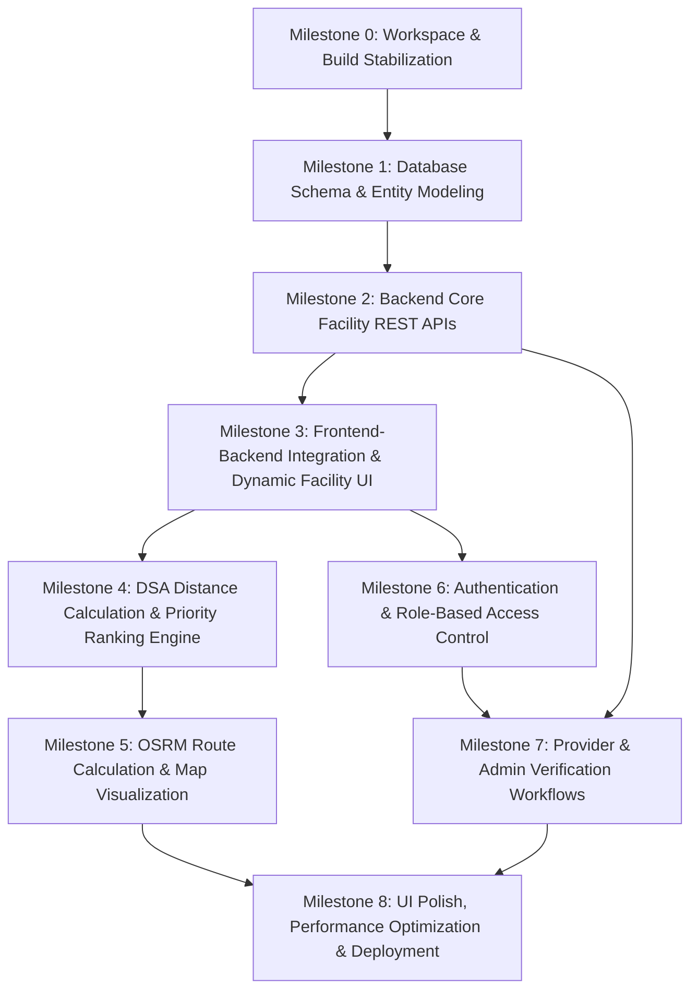

# RescueRoute Development Roadmap

## 1. Overview & Working Strategy

This roadmap defines the definitive milestone-based path to take RescueRoute from its current MVP prototype to a complete, stable, portfolio-ready emergency healthcare routing application.

### Core Principles
- **Spec-Driven**: All implementations must follow [docs/MASTER_SPEC.md](file:///d:/01_Career/4_DSA/RescueRoute-DSA-Project/docs/MASTER_SPEC.md), [docs/ARCHITECTURE.md](file:///d:/01_Career/4_DSA/RescueRoute-DSA-Project/docs/ARCHITECTURE.md), [docs/DATABASE_SCHEMA.md](file:///d:/01_Career/4_DSA/RescueRoute-DSA-Project/docs/DATABASE_SCHEMA.md), [docs/API_SPEC.md](file:///d:/01_Career/4_DSA/RescueRoute-DSA-Project/docs/API_SPEC.md), and [ADRs 01–05](file:///d:/01_Career/4_DSA/RescueRoute-DSA-Project/docs/adr).
- **Stabilize First**: Existing build failures, documentation merge conflicts, and credential exposures are resolved before expanding features.
- **Dependency-Driven Sequence**: Each milestone strictly builds upon the verified deliverables of earlier milestones.
- **DSA Priority**: Emphasize explicit, transparent Data Structures & Algorithms (spatial calculations, custom priority queues, ranking logic) rather than delegating all logic to black-box libraries.
- **Pareto Efficiency**: Implement clean, robust, and maintainable solutions without unnecessary frameworks or premature over-engineering.

---

## 2. Current Implementation Status Matrix

| Component / Layer | Status | Current Reality vs. Target State |
| :--- | :--- | :--- |
| **Workspace & Tooling** | **COMPLETED** | Frontend build stable; clean scripts; no merge conflicts; env secrets secured. |
| **Frontend Map UI** | **COMPLETED** | Leaflet map with Karachi bounds, live API facilities, category pages, routing polyline, and ranked facilities list. |
| **Backend Foundation** | **COMPLETED** | Spring Boot REST APIs with `ApiResponse<T>`, exception handling, DTOs, and health checks. |
| **Database Layer** | **COMPLETED** | Neon PostgreSQL configured with normalized schema (`facilities`, subtypes, `verification_requests`, `admin_logs`, `routes`). |
| **DSA / Ranking** | **COMPLETED** | Haversine distance calculation and custom Top-K Min-Heap priority ranking engine implemented and verified. |
| **Authentication & Roles**| **COMPLETED** | Spring Security with BCrypt, JWT stateless authentication, role checks (USER, PROVIDER, ADMIN), and React `AuthContext`. |
| **Provider / Admin** | **COMPLETED** | Provider facility submission (`POST /api/v1/facilities`), verification request moderation queue, admin approval/rejection (`PUT /api/v1/admin/verification-requests/{id}`), audit logging (`admin_logs`), and provider & admin UI with role-based routing. |

---

## 3. Milestones Overview & Dependency Graph

---

## 4. Detailed Milestone Specifications

### Milestone 0: Workspace & Build Stabilization
* **Goal**: Eliminate blocking build failures, resolve documentation conflicts, and secure database credentials so the project builds cleanly in all environments.
* **Tasks Included**:
  * Fix file casing discrepancy for [`BloodBanksPage.tsx`](file:///d:/01_Career/4_DSA/RescueRoute-DSA-Project/frontend/src/pages/BloodBanks/BloodBankspage.tsx) to resolve TypeScript error `TS1261`.
  * Clean up unresolved Git merge conflicts in [`docs/ARCHITECHTURE.md`](file:///d:/01_Career/4_DSA/RescueRoute-DSA-Project/docs/ARCHITECHTURE.md) and [`docs/API_SPEC.md`](file:///d:/01_Career/4_DSA/RescueRoute-DSA-Project/docs/API_SPEC.md).
  * Externalize Neon database credentials in `application.properties` to environment variables (`SPRING_DATASOURCE_URL`, `SPRING_DATASOURCE_USERNAME`, `SPRING_DATASOURCE_PASSWORD`) with safe defaults.
* **Frontend Work**: Rename file / import to ensure casing matches exactly; verify TypeScript passes.
* **Backend Work**: Update `application.properties` to read datasource properties from environment variables.
* **Database Work**: None.
* **DSA / Algorithm Work**: None.
* **Dependencies**: None.
* **Verification Criteria**:
  * `npm run build` in `frontend/` succeeds with exit code 0.
  * `mvnw test-compile` in `backend/` succeeds with exit code 0.
  * No git merge conflict markers remain in `docs/`.
* **Expected Final State**: Clean, stable workspace where both frontend and backend build without any errors.

---

### Milestone 1: Database Schema & Entity Modeling
* **Goal**: Establish the relational data model in Neon PostgreSQL and map it to Java JPA entities per [docs/DATABASE_SCHEMA.md](file:///d:/01_Career/4_DSA/RescueRoute-DSA-Project/docs/DATABASE_SCHEMA.md).
* **Tasks Included**:
  * Create `database/schema.sql` defining normalized DDL for `users`, `facilities`, `hospitals`, `blood_banks`, `pharmacies`, `ambulances`.
  * Create `database/seed.sql` with verified emergency facilities across Karachi.
  * Implement JPA entity hierarchy in `backend/src/main/java/com/huzaifa/rescueroute/entity/` (`Facility`, `Hospital`, `BloodBank`, `Pharmacy`, `Ambulance`, `User`).
  * Create Spring Data JPA repositories in `repository/`.
* **Frontend Work**: None.
* **Backend Work**: Map JPA entities, relationships (`@OneToOne`, `@ManyToOne`), and repository interfaces.
* **Database Work**: Execute schema and seed scripts in Neon PostgreSQL; verify tables and constraints.
* **DSA / Algorithm Work**: None.
* **Dependencies**: Milestone 0.
* **Verification Criteria**:
  * Spring Boot boots and Hibernate updates/validates tables against Neon PostgreSQL without errors.
  * Seed data for Karachi facilities is successfully queryable via repositories.
* **Expected Final State**: Neon PostgreSQL contains production-structured tables populated with Karachi medical resource records, mapped directly to JPA entities.

---

### Milestone 2: Backend Core Facility REST APIs
* **Goal**: Expose robust REST endpoints for querying medical facilities per [docs/API_SPEC.md](file:///d:/01_Career/4_DSA/RescueRoute-DSA-Project/docs/API_SPEC.md).
* **Tasks Included**:
  * Create DTOs (`FacilityResponseDto`, `HospitalDetailsDto`, etc.) and mapper logic.
  * Implement `FacilityService` supporting list, filter by facility type, city, and ID lookup.
  * Implement `FacilityController` with base path `/api/v1/facilities`:
    * `GET /api/v1/facilities` (query params: `type`, `city`, `active`)
    * `GET /api/v1/facilities/{id}` (full subtype details)
  * Write unit tests for `FacilityService` and integration tests for `FacilityController`.
* **Frontend Work**: None.
* **Backend Work**: Service, controller, validation, and standard `ApiResponse<T>` wrapping.
* **Database Work**: Read queries against `facilities` and subtype tables.
* **DSA / Algorithm Work**: None.
* **Dependencies**: Milestone 1.
* **Verification Criteria**:
  * Endpoints return HTTP 200 with standard `ApiResponse` envelope when valid.
  * Non-existent ID returns HTTP 404 with `ResourceNotFoundException`.
  * Unit/integration tests pass (`mvn test`).
* **Expected Final State**: Functional read-only REST API serving real Karachi facility data from PostgreSQL.

---

### Milestone 3: Frontend-Backend Integration & Dynamic Facility UI
* **Goal**: Replace hardcoded mock data in the React frontend with live data fetched from the backend API.
* **Tasks Included**:
  * Implement Axios HTTP client in [`frontend/src/services/api.ts`](file:///d:/01_Career/4_DSA/RescueRoute-DSA-Project/frontend/src/services/api.ts) with base URL configuration.
  * Create `facilityService.ts` for calling `GET /api/v1/facilities`.
  * Update [`HomePage.tsx`](file:///d:/01_Career/4_DSA/RescueRoute-DSA-Project/frontend/src/pages/Home/HomePage.tsx) to fetch facilities on mount with loading and error states.
  * Implement [`Loading.tsx`](file:///d:/01_Career/4_DSA/RescueRoute-DSA-Project/frontend/src/components/ui/Loading.tsx) and [`ErrorMessage.tsx`](file:///d:/01_Career/4_DSA/RescueRoute-DSA-Project/frontend/src/components/ui/ErrorMessage.tsx).
  * Populate dedicated category pages (`HospitalsPage`, `BloodBanksPage`, `PharmaciesPage`, `AmbulancesPage`) using shared facility list/grid views.
* **Frontend Work**: Service layer, state management (`useState`, `useEffect`), UI feedback states, category screens.
* **Backend Work**: Enable CORS for the frontend origin in Spring Boot configuration.
* **Database Work**: None.
* **DSA / Algorithm Work**: None.
* **Dependencies**: Milestone 2.
* **Verification Criteria**:
  * Loading spinner appears while data fetches; map and lists render live backend data.
  * Filter and search interact dynamically with fetched dataset.
  * Category navigation routes display their respective facility types.
* **Expected Final State**: Fully integrated frontend displaying dynamic emergency resources sourced from the database.

---

### Milestone 4: DSA Distance Calculation & Priority Ranking Engine
* **Goal**: Deliver the core DSA requirement by implementing spatial distance calculations and a multi-criteria priority ranking engine.
* **Tasks Included**:
  * **Haversine Distance Algorithm**: Compute great-circle distance (km) between user coordinates $(lat_1, lng_1)$ and facility coordinates $(lat_2, lng_2)$.
  * **Multi-Criteria Ranking Formula**:
    $$Score = (W_{dist} \times (1 - \frac{distance}{max\_distance})) + (W_{verif} \times is\_verified) + (W_{avail} \times emergency\_available)$$
  * **Custom Priority Queue / Sorting**:
    * Implement an algorithmic ranking structure (or comparator-based min/max heap) prioritizing facilities by suitability score and distance.
  * Expose ranking via endpoint: `GET /api/v1/facilities/search?lat={lat}&lng={lng}&type={type}&emergency={true/false}`.
  * Add geolocation prompt / manual coordinate selection on the frontend.
  * Display ranked results sidebar alongside the map showing calculated distance and match score.
* **Frontend Work**: Location input, geolocation hook, ranked results list with distance tags.
* **Backend Work**: Algorithmic ranking service (`RankingService`), Haversine utility, search controller.
* **Database Work**: Optimized spatial bounding query or indexed retrieval by city/type.
* **DSA / Algorithm Work**:
  * Explicit mathematical Haversine formula implementation.
  * Multi-criteria weighting heuristic.
  * Min-heap / Priority Queue for top-$K$ facility ranking ($O(N \log K)$ efficiency).
* **Dependencies**: Milestone 3.
* **Verification Criteria**:
  * Facilities are sorted correctly by calculated distance from user position.
  * Emergency-ready and verified facilities rank higher when emergency flag is enabled.
  * Unit tests thoroughly validate distance formulas and sorting correctness.
* **Expected Final State**: Transparent DSA-driven ranking engine providing prioritized emergency options based on user location and emergency urgency.

---

### Milestone 5: OSRM Route Calculation & Map Visualization
* **Goal**: Implement road-based route calculation and interactive polyline rendering per [ADR-05](file:///d:/01_Career/4_DSA/RescueRoute-DSA-Project/docs/adr/ADR-05-routing-Strategy.md).
* **Tasks Included**:
  * Integrate public OSRM Routing API (`https://router.project-osrm.org/route/v1/driving/...`).
  * Add routing client to retrieve road route coordinates, travel distance, and duration.
  * Frontend Leaflet polyline overlay on [`MapView.tsx`](file:///d:/01_Career/4_DSA/RescueRoute-DSA-Project/frontend/src/components/map/MapView.tsx) connecting user position to selected facility.
  * Interactive route summary card displaying travel duration (minutes) and distance (km).
* **Frontend Work**: React-Leaflet `Polyline`, route state handling, selected facility highlight, travel time badge.
* **Backend Work**: Optional backend routing proxy or direct frontend client per ADR-05.
* **Database Work**: (Optional) Route audit log in `routes` table per schema.
* **DSA / Algorithm Work**: Decoding OSRM polyline geometries; shortest path visualization.
* **Dependencies**: Milestone 4.
* **Verification Criteria**:
  * Clicking "Get Directions" draws a visible route along actual streets on the Karachi map.
  * Estimated driving time and distance update accurately.
* **Expected Final State**: Full visual navigation experience showing driving path, time, and distance to chosen emergency facility.

---

### Milestone 6: Authentication & Role-Based Access Control [COMPLETED]
* **Goal**: Implement secure user registration, login, and JWT-based authentication for `USER`, `PROVIDER`, and `ADMIN` roles.
* **Tasks Included**:
  * Backend Spring Security filter chain with JJWT 0.12.6 stateless authentication provider.
  * Endpoints: `POST /api/v1/auth/register`, `POST /api/v1/auth/login`, `GET /api/v1/auth/me`.
  * Password hashing using BCrypt; admin self-registration rejection.
  * Standardized JSON error envelopes (401 Unauthorized, 403 Forbidden) via custom entry point and access denied handler.
  * Frontend `AuthContext`, `authService`, token storage in localStorage, and Axios JWT request/response interceptors.
  * Reusable `ProtectedRoute` guard supporting role-based access control.
  * Functional `Navbar` with role badges, user email/name, and login/logout state.
  * Functional `LoginPage.tsx` with Sign In and Registration tabs, input validation, and role selection.
* **Frontend Work**: Login/Register forms, `AuthContext`, `useAuth`, `Navbar`, `ProtectedRoute`, token management.
* **Backend Work**: `SecurityConfig`, `JwtService`, `JwtAuthenticationFilter`, `UserDetailsServiceImpl`, `AuthService`, `AuthController`.
* **Database Work**: Persist users to `users` table; enforce unique email constraint; BCrypt hashed passwords.
* **DSA / Algorithm Work**: None.
* **Dependencies**: Milestone 3.
* **Verification Criteria**:
  * User can register, log in, receive JWT, and access `/api/v1/auth/me`.
  * Invalid credentials return 401 Unauthorized with standardized error JSON.
  * Missing or malformed JWT returns 401 Unauthorized.
  * Full automated test suite passes (57 tests total).
* **Final State**: Secure role-aware application permitting authenticated sessions, fully preserving Milestones 0-5 emergency discovery and routing capabilities.

---

### Milestone 7: Provider & Admin Verification Workflows
* **Status**: **COMPLETED**
* **Goal**: Allow medical providers to register facilities and administrators to verify records per [docs/DATABASE_SCHEMA.md](file:///d:/01_Career/4_DSA/RescueRoute-DSA-Project/docs/DATABASE_SCHEMA.md).
* **Tasks Included**:
  * Provider workflow:
    * `POST /api/v1/facilities` (Provider creates facility; set to unverified).
    * Auto-create record in `verification_requests`.
  * Admin workflow:
    * `GET /api/v1/admin/verification-requests` (List pending requests with submitter/facility details).
    * `PUT /api/v1/admin/verification-requests/{id}` (Approve or Reject with notes).
    * Insert action into `admin_logs`.
  * Frontend Provider Facility Form ([`ProviderFacilityPage.tsx`](file:///d:/01_Career/4_DSA/RescueRoute-DSA-Project/frontend/src/pages/Provider/ProviderFacilityPage.tsx)) with dynamic subtype fields for Hospital, Blood Bank, Pharmacy, Ambulance.
  * Frontend Admin Moderation Dashboard ([`AdminVerificationPage.tsx`](file:///d:/01_Career/4_DSA/RescueRoute-DSA-Project/frontend/src/pages/Admin/AdminVerificationPage.tsx)) with pending/review views and notes for rejection.
  * Protected route guards in [`AppRouter.tsx`](file:///d:/01_Career/4_DSA/RescueRoute-DSA-Project/frontend/src/routes/AppRouter.tsx) enforcing `PROVIDER` and `ADMIN` role access.
* **Frontend Work**: Provider creation form, Admin verification dashboard, status badges.
* **Backend Work**: Role-restricted endpoints (`@PreAuthorize("hasRole('ADMIN')")`, `@PreAuthorize("hasRole('PROVIDER')")`), `VerificationWorkflowService`.
* **Database Work**: Transactions updating `facilities.is_verified`, `verification_requests`, and `admin_logs`.
* **DSA / Algorithm Work**: Verified automatic ranking score boost upon facility approval by existing Top-K heap engine.
* **Dependencies**: Milestone 6 (Auth) and Milestone 2 (Facilities).
* **Verification Criteria**:
  * Provider can submit a facility; it does not appear as verified until approved.
  * Admin approval immediately updates `is_verified` and elevates ranking score.
  * All 78 backend tests and frontend lint/build pass.
* **Final State**: Robust, transactional data lifecycle enabling provider facility onboarding and administrative moderation.

---

### Milestone 8: UI Polish, Performance Optimization & Deployment Readiness
* **Goal**: Optimize assets, polish responsive UI, run comprehensive automated testing, and deploy to Vercel and Render per [docs/DEPLOYMENT_GUIDE.md](file:///d:/01_Career/4_DSA/RescueRoute-DSA-Project/docs/DEPLOYMENT_GUIDE.md).
* **Tasks Included**:
  * Asset compression: Compress `hospital.png` (9MB) and `blood-bank.png` (6MB) to WebP/PNG (< 50KB each).
  * Polish layout, typography, navigation bar, and footer per [docs/UI_UX_GUIDELINES.md](file:///d:/01_Career/4_DSA/RescueRoute-DSA-Project/docs/UI_UX_GUIDELINES.md).
  * Execute test suites across frontend and backend per [docs/TESTING_STRATEGY.md](file:///d:/01_Career/4_DSA/RescueRoute-DSA-Project/docs/TESTING_STRATEGY.md).
  * Configure environment variables for Vercel (Frontend) and Render (Backend).
  * Update root `README.md` with complete project overview, architecture diagrams, live demo links, and setup guides.
* **Frontend Work**: Asset optimization, responsive layout polish, production build verification.
* **Backend Work**: Production profile (`application-prod.properties`), CORS configuration for Vercel domain.
* **Database Work**: Production connection check on Neon PostgreSQL.
* **DSA / Algorithm Work**: Performance profiling on top-$K$ ranking with large facility datasets.
* **Dependencies**: Milestones 0 through 7.
* **Verification Criteria**:
  * Production frontend builds cleanly and loads instantly (LCP < 2s).
  * Backend deploys to Render and connects to Neon DB.
  * Public URL allows full flow: search $\rightarrow$ filter $\rightarrow$ rank $\rightarrow$ route.
* **Expected Final State**: High-quality, publicly deployed emergency healthcare routing portfolio project.