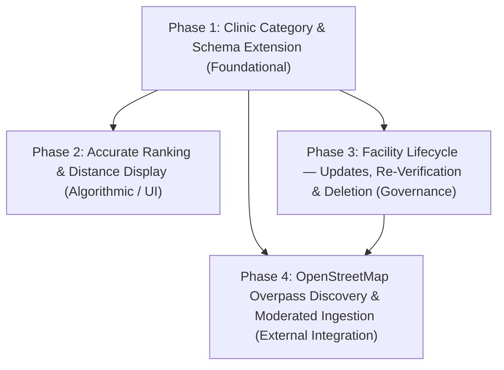

# RescueRoute — Comprehensive Improvement Implementation Plan

## 1. Executive Summary & Context

RescueRoute is an emergency healthcare discovery and navigation platform built with **React 18 + TypeScript + Vite**, **Java 21 + Spring Boot 3**, and **Neon Serverless PostgreSQL**. The application provides geospatial facility search, DSA-driven facility ranking (Top-K Min-Heap with multi-criteria scoring), OSRM driving route navigation, and role-based access control (`USER`, `PROVIDER`, `ADMIN`).

While Milestones 0–7 established the foundational architecture, the recent senior architecture audit identified critical missing capabilities, schema constraints, and mathematical model mismatches:
1. **Distance Metric Discrepancy**: Ranked cards display geodesic straight-line distance (Haversine), while route banners display road-network distance and ETA (OSRM). Urban topology (e.g., rivers, rail lines) causes straight-line distance to invert real-world driving distance and travel time.
2. **Missing Provider Facility Updates**: Providers cannot edit existing facilities, and the backend lacks a `PUT /api/v1/facilities/{id}` endpoint and a change-staging mechanism. In-place updates would overwrite active, admin-verified healthcare data prior to moderation.
3. **Missing Facility Deletion**: No `DELETE` endpoint exists. Permanent SQL deletion would trigger cascading purges across verification history and emergency route logs. Reversible soft-deletion (`is_active = FALSE`) is required.
4. **Data Isolation Gap for External POIs**: Discovering nearby facilities via OpenStreetMap (Overpass API) requires a strict 4-tier lifecycle separating transient external POIs from verified persistent records.
5. **Incomplete Clinic Support**: Clinic is missing from the database check constraints, JPA entities, DTO validation, ranking availability logic, and frontend UI components.

This document establishes the **authoritative, sequential, dependency-based implementation plan** to address these issues systematically across **four independently verifiable phases**.

---

## 2. Core Architectural Decisions

Before executing any phase, the following core architectural decisions govern all changes:

### Decision 1: Two-Stage Hybrid Ranking Engine (Issue A)
* **Strategy**: Retain the $O(N \log K)$ bounded Min-Heap using Haversine distance as an ultra-fast initial candidate filter to select the Top-$M$ candidates ($M = 2K$, e.g., 10 candidates for $K=5$). Then, execute a single batch 1-to-$M$ distance matrix call against the OSRM `/table/v1/driving` API to retrieve true driving distances and durations (seconds).
* **Reranking**: Rerank the shortlisted candidates using road travel time (ETA) as the primary distance metric in the multi-criteria score formula.
* **Resilient Fallback**: If OSRM is unreachable, times out ($>2000$ ms), or returns an error, the system automatically and gracefully falls back to the pure Haversine ranking without failing the request.
* **Dual Metric Representation**:
  - API response (`RankedFacilityResponseDto`) will provide both `straightLineDistanceKm` and optional `roadDistanceKm` + `estimatedDurationMinutes`.
  - UI cards will explicitly label metrics (e.g., `📍 6.3 km (straight-line)` vs. `🚗 9.0 km • 12 min (driving)`).

### Decision 2: Proposed-Change Snapshot Pattern for Re-Verification (Issue B)
* **Strategy**: When an authenticated provider updates an already approved facility (`is_verified = TRUE`), the live active facility record is **never modified in-place**.
* **Storage**: A `proposed_changes JSONB` column is added to `verification_requests`.
* **State Machine**:
  - The live record remains visible to public users with its existing verified attributes.
  - A new `verification_requests` record is inserted with `status = 'PENDING'` and the serialized update payload in `proposed_changes`.
  - The facility record receives `has_pending_update = TRUE` to indicate moderation in progress.
  - **On Admin Approval**: Staged changes from `proposed_changes` are applied to the active `facilities` entity within a single `@Transactional` boundary, `has_pending_update` is cleared, and an `AdminLog` is created.
  - **On Admin Rejection**: The request is marked `REJECTED` with review notes; the active facility record remains untouched and verified.

### Decision 3: Reversible Soft Deletion Policy (Issue C)
* **Strategy**: Execute logical soft-deletion exclusively (`facilities.is_active = FALSE`).
* **Justification**: Permanent SQL `DELETE` cascades across `verification_requests`, `hospitals`, `pharmacies`, `ambulances`, `blood_banks`, and `routes`, destroying emergency trip logs and leaving dangling pointers in `admin_logs.target_entity_id`.
* **Behavior**: Setting `is_active = FALSE` immediately excludes the facility from public search, maps, and ranking (via `FacilitySpecifications.withFilters`), while preserving complete legal and audit history.
* **Authorization**: Providers can deactivate only facilities where `created_by == currentUser.id`. Admins can deactivate any facility.

### Decision 4: Four-Tier Lifecycle for OpenStreetMap Overpass POIs (Issue D)
* **Strategy**: Strict tiering between external data and persistent directory:
  1. *Tier 1 — Transient External POIs*: Bounded query (radius 5 km around Point A) cached server-side (TTL 24 hours). Returned with an `externalOsm: true` flag and rendered with distinct visual styling. Never persisted to the database automatically.
  2. *Tier 2 — Staged Import*: When an administrator selects an external POI to ingest, it is saved into `facilities` with `is_verified = FALSE`, `data_source = 'OSM'`, and `external_osm_id = <osm_id>`.
  3. *Tier 3 — Moderation Queue*: Auto-generates a `verification_requests` item with external source attribution.
  4. *Tier 4 — Admin Verified Facility*: Upon admin approval, `is_verified = TRUE`, integrating the facility into the official ranked directory.
* **Deduplication**: Spatial proximity threshold (within 100 meters) combined with normalized name similarity ($>0.80$ string distance) against existing Neon facilities.
* **Integrity**: Missing external fields (phone, ICU beds, emergency status) are never fabricated.

### Decision 5: End-to-End Clinic Category Integration (Issue E)
* **Strategy**: Treat `Clinic` as a complete, first-class facility type alongside `Hospital`, `Pharmacy`, `Blood Bank`, and `Ambulance`.
* **Persistence**: Update database check constraints (`CHECK (facility_type IN (...))`) and create a dedicated `clinics` subtype table for outpatient and consultation capabilities.
* **Full Stack**: Synchronize Java DTO regex, validation annotations, entity mappings, ranking availability scoring, frontend TypeScript types, filter bars, map markers, and provider submission forms.

---

## 3. Dependency Graph & Phase Overview



| Phase ID | Phase Name | Primary Objectives | Prerequisites |
| :--- | :--- | :--- | :--- |
| **Phase 1** | **Clinic Category & Schema Alignment** | Add `Clinic` to database constraints, JPA entities, DTOs, ranking logic, frontend types, map markers, and forms. | None |
| **Phase 2** | **Accurate Ranking & Dual Distance Presentation** | Implement Two-Stage Hybrid ranking (Min-Heap + OSRM Table Matrix), explicit straight-line vs. road metrics in API/UI, and fallback logic. | Phase 1 |
| **Phase 3** | **Facility Lifecycle: Updates, Re-Verification & Deletion** | Add `PUT` and `DELETE` endpoints, proposed-change JSONB snapshot, ownership authorization, admin diff review, and soft deactivation. | Phase 1 |
| **Phase 4** | **OpenStreetMap Overpass Discovery & Ingestion** | Implement bounded Overpass querying, caching, deduplication, transient POI display, and admin import/verification workflow. | Phase 1, Phase 3 |

---

## 4. Phase Specifications

### Phase 1: First-Class Clinic Support & Schema Alignment

#### 1. Goal
Establish `Clinic` as a fully supported, first-class healthcare category across all database constraints, backend entities, validation rules, ranking algorithms, frontend types, navigation bars, and map rendering components.

#### 2. Problems Addressed
- Database check constraint violation (`facilities_facility_type_check`) when inserting `'Clinic'`.
- Backend DTO `@Pattern` regex rejecting `'Clinic'` with HTTP 400.
- Missing subtype table and enrichment logic for outpatient clinics.
- Missing TypeScript definitions, navigation links, map pin icons, and category badges in the frontend.

#### 3. Prerequisites & Dependencies
- Neon PostgreSQL database connection active.
- Existing codebase baseline in `backend/` and `frontend/`.

#### 4. Database & Schema Tasks
- File: [`database/schema.sql`](file:///d:/01_Career/4_DSA/RescueRoute-DSA-Project/database/schema.sql)
  - Update `facilities` check constraint:
    ```sql
    ALTER TABLE facilities DROP CONSTRAINT IF EXISTS facilities_facility_type_check;
    ALTER TABLE facilities ADD CONSTRAINT facilities_facility_type_check 
        CHECK (facility_type IN ('Hospital', 'Blood Bank', 'Pharmacy', 'Ambulance', 'Clinic'));
    ```
  - Create `clinics` table:
    ```sql
    CREATE TABLE IF NOT EXISTS clinics (
        id UUID PRIMARY KEY DEFAULT gen_random_uuid(),
        facility_id UUID UNIQUE NOT NULL REFERENCES facilities(id) ON DELETE CASCADE,
        consultation_available BOOLEAN NOT NULL DEFAULT TRUE,
        specialties TEXT,
        open_weekends BOOLEAN NOT NULL DEFAULT FALSE,
        notes TEXT
    );
    CREATE INDEX IF NOT EXISTS idx_clinics_facility_id ON clinics(facility_id);
    ```
- File: [`database/seed.sql`](file:///d:/01_Career/4_DSA/RescueRoute-DSA-Project/database/seed.sql)
  - Add representative seed clinics in Karachi (e.g., Al-Khidmat Diagnostic & Clinic, Dow Medical Family Clinic).

#### 5. Backend Tasks
- **Entity**: Create `Clinic.java` in `com.huzaifa.rescueroute.entity` linked `@OneToOne` with `Facility.java`.
- **Entity Update**: In [`Facility.java`](file:///d:/01_Career/4_DSA/RescueRoute-DSA-Project/backend/src/main/java/com/huzaifa/rescueroute/entity/Facility.java), add:
  ```java
  @OneToOne(mappedBy = "facility", cascade = CascadeType.ALL, fetch = FetchType.LAZY)
  private Clinic clinic;
  ```
- **DTOs**:
  - Create `ClinicDetailsDto.java` (`consultationAvailable`, `specialties`, `openWeekends`, `notes`).
  - In [`CreateFacilityRequestDto.java`](file:///d:/01_Career/4_DSA/RescueRoute-DSA-Project/backend/src/main/java/com/huzaifa/rescueroute/dto/CreateFacilityRequestDto.java), update `@Pattern` to `^(Hospital|Blood Bank|Pharmacy|Ambulance|Clinic)$` and add `private ClinicDetailsDto clinicDetails;`.
  - In [`FacilityResponseDto.java`](file:///d:/01_Career/4_DSA/RescueRoute-DSA-Project/backend/src/main/java/com/huzaifa/rescueroute/dto/FacilityResponseDto.java), add `private ClinicDetailsDto clinicDetails;`.
- **Repository**: Create `ClinicRepository.java` extending `JpaRepository<Clinic, UUID>`.
- **Mapper**: Update [`FacilityMapper.java`](file:///d:/01_Career/4_DSA/RescueRoute-DSA-Project/backend/src/main/java/com/huzaifa/rescueroute/mapper/FacilityMapper.java) to map `Clinic` entity $\leftrightarrow$ `ClinicDetailsDto`.
- **Workflow & Service**:
  - In [`VerificationWorkflowServiceImpl.java`](file:///d:/01_Career/4_DSA/RescueRoute-DSA-Project/backend/src/main/java/com/huzaifa/rescueroute/service/impl/VerificationWorkflowServiceImpl.java), handle `"Clinic"` in `attachSubtype()`.
  - In [`RankingServiceImpl.java`](file:///d:/01_Career/4_DSA/RescueRoute-DSA-Project/backend/src/main/java/com/huzaifa/rescueroute/service/impl/RankingServiceImpl.java), update `checkEmergencyAvailability()` and `enrichSubtypeIfMissing()` for Clinic.

#### 6. Frontend Tasks
- **Types**: In [`facility.ts`](file:///d:/01_Career/4_DSA/RescueRoute-DSA-Project/frontend/src/types/facility.ts), update:
  ```ts
  export type FacilityType = "Hospital" | "Blood Bank" | "Pharmacy" | "Ambulance" | "Clinic";
  export interface ClinicDetails { ... }
  ```
- **Navigation & Badges**:
  - Update [`Navbar.tsx`](file:///d:/01_Career/4_DSA/RescueRoute-DSA-Project/frontend/src/components/layout/Navbar.tsx) to add `"Clinics"` (`/clinics`) to navigation links.
  - In [`RankedFacilityCard.tsx`](file:///d:/01_Career/4_DSA/RescueRoute-DSA-Project/frontend/src/components/facility/RankedFacilityCard.tsx), add Clinic badge styling (`#0891b2` teal / cyan palette).
- **Map Pin Icons**: Update Leaflet marker icons in [`MapView.tsx`](file:///d:/01_Career/4_DSA/RescueRoute-DSA-Project/frontend/src/components/map/MapView.tsx) to render a distinctive clinic cross/stethoscope icon.
- **Provider Submission**: In [`CreateFacilityModal.tsx`](file:///d:/01_Career/4_DSA/RescueRoute-DSA-Project/frontend/src/components/facility/CreateFacilityModal.tsx) / [`CreateFacilityPage.tsx`](file:///d:/01_Career/4_DSA/RescueRoute-DSA-Project/frontend/src/pages/Provider/CreateFacilityPage.tsx), add `"Clinic"` to the dropdown with fields for specialties and consultation availability.
- **Dedicated Page**: Create [`ClinicsPage.tsx`](file:///d:/01_Career/4_DSA/RescueRoute-DSA-Project/frontend/src/pages/Clinics/ClinicsPage.tsx) following the pattern of existing category pages.

#### 7. API & Architectural Changes
- Endpoints `GET /api/v1/facilities?type=Clinic` and `GET /api/v1/facilities/search?type=Clinic` become fully active.
- `POST /api/v1/facilities` accepts `facilityType: "Clinic"` with `clinicDetails`.

#### 8. Security & Data Integrity Requirements
- Strict DTO validation ensures invalid facility types are rejected before persistence.
- Cascading delete on `clinics(facility_id)` preserves referential integrity.

#### 9. Tests & Verification Criteria
- **Unit Tests**:
  - `FacilityMapperTest`: Clinic entity-to-DTO and DTO-to-entity mapping.
  - `RankingServiceTest`: Clinic availability scoring under normal and emergency modes.
- **Integration Tests**:
  - `FacilityControllerIntegrationTest`: POST a new Clinic, verify HTTP 201 and database row creation in both `facilities` and `clinics`.
  - GET `/api/v1/facilities?type=Clinic` returns matching clinics.
- **Frontend Verification**: `npm run build` passes with zero TypeScript errors (`TS2322`).

#### 10. Acceptance Criteria
- [ ] Database accepts `'Clinic'` rows without check constraint violation.
- [ ] Provider can select Clinic, fill clinic details, and submit for verification.
- [ ] Clinics appear in `/clinics` page, category filter, and map with teal styling.
- [ ] Backend tests and frontend build pass with exit code 0.

---

### Phase 2: Accurate Ranking & Distance Display (Two-Stage Hybrid Engine)

#### 1. Goal
Eliminate the discrepancy between straight-line distance on ranking cards and driving distance on route summaries by implementing a Two-Stage Hybrid ranking approach that combines fast DSA candidate pruning with OSRM road travel time re-ranking, and displays explicit metrics in the UI.

#### 2. Problems Addressed
- Geodesic distance (Haversine) fails to account for Karachi's urban road barriers (Lyari River, railway tracks, cantonment boundaries).
- Indus Hospital (6.3 km straight-line, 9.0 km driving) ranking ahead of JPMC (6.6 km straight-line, 8.7 km driving) due to straight-line metric bias.
- Card distances silently representing straight-line distance while route summaries display road distance.
- Risk of OSRM public API rate limits if querying road distance for all $N$ database candidates.

#### 3. Prerequisites & Dependencies
- Phase 1 complete (all facility categories including Clinic supported).
- OSRM service operational (with timeout and fallback handling).

#### 4. Database & Schema Tasks
- No schema changes required.

#### 5. Backend Tasks
- **DTO Updates**:
  - In [`RankedFacilityResponseDto.java`](file:///d:/01_Career/4_DSA/RescueRoute-DSA-Project/backend/src/main/java/com/huzaifa/rescueroute/dto/RankedFacilityResponseDto.java), add:
    ```java
    private Double straightLineDistanceKm; // Geodesic Haversine
    private Double roadDistanceKm;         // OSRM road distance (nullable if fallback)
    private Integer estimatedDurationMinutes; // OSRM driving ETA (nullable if fallback)
    private String distanceMetricUsed;     // "ROAD_NETWORK" or "STRAIGHT_LINE"
    ```
- **OSRM Client / Matrix Integration**:
  - Create `OsrmRoutingClient.java` in `com.huzaifa.rescueroute.client`:
    - Method: `calculateDistanceMatrix(Double userLat, Double userLng, List<Facility> candidates)`
    - Calls OSRM Table API: `https://router.project-osrm.org/table/v1/driving/{coords}?sources=0&annotations=distance,duration`
    - Configured with `RestTemplate` / `WebClient`, connection timeout 1500 ms, read timeout 2000 ms.
- **Two-Stage Ranking Logic**:
  - In [`RankingServiceImpl.java`](file:///d:/01_Career/4_DSA/RescueRoute-DSA-Project/backend/src/main/java/com/huzaifa/rescueroute/service/impl/RankingServiceImpl.java):
    - **Stage 1 (DSA Spatial Shortlist)**: Use existing Haversine calculation and [TopKRankingEngine.java](file:///d:/01_Career/4_DSA/RescueRoute-DSA-Project/backend/src/main/java/com/huzaifa/rescueroute/dsa/TopKRankingEngine.java) to select the top $M = \min(N, 2K)$ candidates in $O(N \log M)$ time.
    - **Stage 2 (Road ETA Re-ranking)**: For the $M$ candidates, query the OSRM table matrix. Update the distance score using normalized travel time ($\text{timeFactor} = 1 - \frac{\text{duration}}{\text{maxDuration}}$).
    - **Fallback**: If OSRM times out or fails, log a warning, set `distanceMetricUsed = "STRAIGHT_LINE"`, and return the Stage 1 Min-Heap ranking.
- **Algorithmic Engine**:
  - In [`TopKRankingEngine.java`](file:///d:/01_Career/4_DSA/RescueRoute-DSA-Project/backend/src/main/java/com/huzaifa/rescueroute/dsa/TopKRankingEngine.java), preserve the core Min-Heap implementation and ensure deterministic tie-breaking.

#### 6. Frontend Tasks
- **Types**: Update [`RankedFacility`](file:///d:/01_Career/4_DSA/RescueRoute-DSA-Project/frontend/src/types/facility.ts) to include `straightLineDistanceKm`, `roadDistanceKm`, `estimatedDurationMinutes`, and `distanceMetricUsed`.
- **Card UI Clarification**:
  - In [`RankedFacilityCard.tsx`](file:///d:/01_Career/4_DSA/RescueRoute-DSA-Project/frontend/src/components/facility/RankedFacilityCard.tsx#L125-L138):
    - If `roadDistanceKm` and `estimatedDurationMinutes` are present:
      ```tsx
      <span className="road-metric">
        🚗 {roadDistanceKm.toFixed(1)} km • {estimatedDurationMinutes} min
      </span>
      <span className="straight-line-subtext">
        (📍 {straightLineDistanceKm.toFixed(1)} km straight-line)
      </span>
      ```
    - If only straight-line distance is available (fallback):
      ```tsx
      <span className="straight-line-metric">
        📍 {straightLineDistanceKm.toFixed(1)} km (straight-line)
      </span>
      ```
- **Route Summary Synchronization**:
  - In [`RouteSummary.tsx`](file:///d:/01_Career/4_DSA/RescueRoute-DSA-Project/frontend/src/components/route/RouteSummary.tsx), ensure the active route distance and travel time correspond cleanly with the road metrics displayed on the selected card.

#### 7. API & Architectural Changes
- `GET /api/v1/facilities/search` returns enriched `RankedFacilityResponseDto` with both distance metrics and the `distanceMetricUsed` indicator.

#### 8. Security & Data Integrity Requirements
- Bounding the OSRM table matrix call to $M \le 10$ coordinates prevents payload inflation and denial-of-service risks.
- Hard timeout (2.0s) prevents slow external OSRM responses from tying up backend worker threads.

#### 9. Tests & Verification Criteria
- **Unit Tests**:
  - `TopKRankingEngineTest`: Verify Min-Heap retains $O(N \log K)$ performance with tie-breaking.
  - `RankingServiceImplTest`: Verify fallback to Haversine when OSRM client throws a timeout exception.
- **Integration Tests**:
  - Search ranking test with mock OSRM table response: Verify candidate with shorter driving time ranks higher even if straight-line distance is slightly greater (e.g. JPMC vs Indus Hospital scenario).
- **Manual / Visual Verification**:
  - Inspect ranking from Sher Shah coordinates `(24.8846, 66.9905)`. Verify card display shows both straight-line and driving metrics clearly.

#### 10. Acceptance Criteria
- [ ] Ranked facility cards explicitly show driving distance/time and straight-line distance.
- [ ] No discrepancy between card driving distance and route banner distance for routed facilities.
- [ ] Bounded OSRM matrix query limits external calls to top shortlisted candidates.
- [ ] Automatic fallback to straight-line ranking when OSRM is offline.
- [ ] Backend tests pass and frontend build succeeds with zero errors.

---

### Phase 3: Facility Lifecycle — Updates, Re-Verification & Soft Deletion

#### 1. Goal
Provide a secure, transactional lifecycle for healthcare facilities: allow providers to update their facilities with safe administrative re-verification (staging proposed changes without dirtying live data), allow providers and admins to safely deactivate facilities via soft deletion, and enforce strict ownership authorization.

#### 2. Problems Addressed
- Missing `PUT /api/v1/facilities/{id}` endpoint preventing providers from updating their facilities.
- Lack of staging in `verification_requests`: in-place updates would overwrite approved active facilities before admin review.
- Missing `DELETE /api/v1/facilities/{id}` endpoint and risk of cascading foreign key deletions.
- Unauthorized cross-provider modifications.

#### 3. Prerequisites & Dependencies
- Phase 1 complete (schema supports all 5 facility types).

#### 4. Database & Schema Tasks
- File: [`database/schema.sql`](file:///d:/01_Career/4_DSA/RescueRoute-DSA-Project/database/schema.sql)
  - Add staging and tracking columns:
    ```sql
    -- Add proposed_changes JSONB to verification_requests
    ALTER TABLE verification_requests ADD COLUMN IF NOT EXISTS proposed_changes JSONB;
    ALTER TABLE verification_requests ADD COLUMN IF NOT EXISTS request_type VARCHAR(50) NOT NULL DEFAULT 'CREATION' CHECK (request_type IN ('CREATION', 'UPDATE'));

    -- Add has_pending_update flag to facilities for UI moderation indicators
    ALTER TABLE facilities ADD COLUMN IF NOT EXISTS has_pending_update BOOLEAN NOT NULL DEFAULT FALSE;
    ```
  - Index new columns:
    ```sql
    CREATE INDEX IF NOT EXISTS idx_verification_requests_request_type ON verification_requests(request_type);
    CREATE INDEX IF NOT EXISTS idx_facilities_has_pending_update ON facilities(has_pending_update);
    ```

#### 5. Backend Tasks
- **DTOs**:
  - Create `UpdateFacilityRequestDto.java` containing editable fields (name, phone, address, coordinates, and subtype details).
  - In `VerificationRequestResponseDto.java`, add `requestType` and `proposedChanges`.
- **Entity Updates**:
  - In `VerificationRequest.java`, add `requestType` and `proposedChanges` fields.
  - In `Facility.java`, add `hasPendingUpdate` boolean.
- **Provider Update Workflow**:
  - In [`VerificationWorkflowService.java`](file:///d:/01_Career/4_DSA/RescueRoute-DSA-Project/backend/src/main/java/com/huzaifa/rescueroute/service/VerificationWorkflowService.java):
    - Method: `submitFacilityUpdate(UUID facilityId, UpdateFacilityRequestDto request, String providerEmail)`
    - Authorization check: verify caller is `ADMIN` or the owning `PROVIDER` (`facility.getCreatedBy().getEmail().equals(providerEmail)`).
    - If facility has an existing `PENDING` request, reject with HTTP 409 Conflict ("A pending verification request is already under review for this facility").
    - Serialize `UpdateFacilityRequestDto` to JSON and persist in a new `verification_requests` row with `request_type = 'UPDATE'`, `status = 'PENDING'`.
    - Mark `facility.setHasPendingUpdate(true)`. The live facility data remains completely unchanged.
- **Admin Moderation & Approval Flow**:
  - In [`VerificationWorkflowServiceImpl.processDecision()`](file:///d:/01_Career/4_DSA/RescueRoute-DSA-Project/backend/src/main/java/com/huzaifa/rescueroute/service/impl/VerificationWorkflowServiceImpl.java#L118):
    - If request is `UPDATE` and decision is `APPROVED`:
      - Deserialize `proposed_changes` and apply updates to the live `Facility` and its subtype entities.
      - Clear `facility.setHasPendingUpdate(false)`.
      - Record `AdminLog` (`action_type = "FACILITY_UPDATE_APPROVED"`).
    - If request is `UPDATE` and decision is `REJECTED`:
      - Clear `facility.setHasPendingUpdate(false)`.
      - Active facility data remains untouched.
      - Record `AdminLog` (`action_type = "FACILITY_UPDATE_REJECTED"`).
- **Soft Deletion Workflow**:
  - In [`FacilityService.java`](file:///d:/01_Career/4_DSA/RescueRoute-DSA-Project/backend/src/main/java/com/huzaifa/rescueroute/service/FacilityService.java):
    - Method: `deactivateFacility(UUID facilityId, String callerEmail)`
    - Authorization check: caller must be `ADMIN` or the owning `PROVIDER`.
    - Set `facility.setActive(false)`.
    - Cancel any `PENDING` verification requests for this facility.
    - Record `AdminLog` (`action_type = "FACILITY_DEACTIVATED"`).
- **Controllers**:
  - In [`FacilityController.java`](file:///d:/01_Career/4_DSA/RescueRoute-DSA-Project/backend/src/main/java/com/huzaifa/rescueroute/controller/FacilityController.java):
    - `@PutMapping("/{id}")` with `@PreAuthorize("hasAnyRole('PROVIDER', 'ADMIN')")`.
    - `@DeleteMapping("/{id}")` with `@PreAuthorize("hasAnyRole('PROVIDER', 'ADMIN')")`.

#### 6. Frontend Tasks
- **Service Integration**:
  - In [`facilityService.ts`](file:///d:/01_Career/4_DSA/RescueRoute-DSA-Project/frontend/src/services/facilityService.ts), add:
    - `updateFacility(id: string, payload: UpdateFacilityPayload)`
    - `deactivateFacility(id: string)`
- **Provider Dashboard / Edit Form**:
  - Create `EditFacilityModal.tsx` allowing providers to modify details of their owned facilities.
  - Display a badge: `"Pending Re-Verification"` on facilities undergoing update review.
- **Admin Diff Review UI**:
  - In [`AdminVerificationsPage.tsx`](file:///d:/01_Career/4_DSA/RescueRoute-DSA-Project/frontend/src/pages/Admin/AdminVerificationsPage.tsx):
    - For `requestType === "UPDATE"`, display a side-by-side comparison showing current active values vs. proposed new values.
    - Provide Approve and Reject action buttons with required review notes.
- **Deactivation Controls**:
  - Add "Deactivate Facility" button in provider facility view and admin view with confirmation dialog (`"Are you sure you want to deactivate this facility? It will be removed from public search."`).

#### 7. API & Architectural Changes
- `PUT /api/v1/facilities/{id}` — Submits update for verification.
- `DELETE /api/v1/facilities/{id}` — Soft-deactivates facility.
- `GET /api/v1/admin/verification-requests` returns `requestType` and `proposedChanges` for diff inspection.

#### 8. Security & Data Integrity Requirements
- Strict ownership verification prevents Provider A from altering Provider B's facility.
- Atomic `@Transactional` boundary guarantees that approving an update atomically updates base data, subtypes, verification status, and audit log.
- Live public search remains protected from unvetted edits at all times.

#### 9. Tests & Verification Criteria
- **Unit Tests**:
  - `VerificationWorkflowServiceTest`:
    - Provider update stages changes without altering live entity.
    - Approval applies staged changes.
    - Rejection discards staged changes and preserves live entity.
    - Cross-provider update throws `AccessDeniedException`.
  - `FacilityServiceTest`:
    - Deactivation sets `isActive = false`.
- **Integration Tests**:
  - `FacilityLifecycleIntegrationTest`: Full end-to-end flow: Create $\to$ Approve $\to$ Edit $\to$ Verify unapproved data is NOT live $\to$ Admin Approve $\to$ Verify updated data is live $\to$ Deactivate $\to$ Verify excluded from search.
- **Regression Check**:
  - Verify `verificationService.ts` endpoints have no duplicate `/api/v1` prefixes.

#### 10. Acceptance Criteria
- [ ] Providers can edit their owned facilities; changes are staged in `verification_requests.proposed_changes`.
- [ ] Active public data is unchanged while update request is pending.
- [ ] Admin can view side-by-side diff in moderation queue and approve or reject.
- [ ] Rejected updates keep previous active data intact.
- [ ] Providers and admins can deactivate facilities via soft-delete; deactivated facilities disappear from search.
- [ ] Cross-provider edits and deactivations return HTTP 403 Forbidden.

---

### Phase 4: OpenStreetMap Overpass Discovery & Moderated Ingestion

#### 1. Goal
Expand facility discovery beyond the pre-seeded database by querying nearby healthcare points of interest via the OpenStreetMap Overpass API, presenting external facilities with distinct unverified visual indicators, and enabling administrators to review, deduplicate, and import external facilities into the verified RescueRoute directory.

#### 2. Problems Addressed
- Limited coverage restricted to the initial seed dataset.
- Risk of unverified external data corrupting emergency routing without moderation.
- Overpass API rate limits (HTTP 429) and network latency from unbounded global queries.
- Duplicate records when a facility exists in both OpenStreetMap and RescueRoute.
- Missing fields in OSM data (phone numbers, emergency readiness).

#### 3. Prerequisites & Dependencies
- Phase 1 complete (supports Hospital, Clinic, Pharmacy, Blood Bank, Ambulance).
- Phase 3 complete (verification and import workflow in place).

#### 4. Database & Schema Tasks
- File: [`database/schema.sql`](file:///d:/01_Career/4_DSA/RescueRoute-DSA-Project/database/schema.sql)
  - Add source tracking to `facilities`:
    ```sql
    ALTER TABLE facilities ADD COLUMN IF NOT EXISTS data_source VARCHAR(50) NOT NULL DEFAULT 'MANUAL' CHECK (data_source IN ('MANUAL', 'OSM'));
    ALTER TABLE facilities ADD COLUMN IF NOT EXISTS external_osm_id BIGINT;
    CREATE UNIQUE INDEX IF NOT EXISTS idx_facilities_external_osm_id ON facilities(external_osm_id) WHERE external_osm_id IS NOT NULL;
    ```

#### 5. Backend Tasks
- **Overpass Client**:
  - Create `OverpassClient.java` in `com.huzaifa.rescueroute.client`:
    - Queries Overpass API (`https://overpass-api.de/api/interpreter`) using bounded circle `(around:radius, lat, lng)`.
    - Tags mapped:
      - Hospital: `amenity=hospital`
      - Clinic: `amenity=clinic` or `healthcare=clinic`
      - Pharmacy: `amenity=pharmacy`
      - Blood Bank: `healthcare=blood_bank`
      - Ambulance: `emergency=ambulance_station`
    - Timeout: 5000 ms.
- **Server-Side Spatial Caching**:
  - In-memory spatial cache (Caffeine or ConcurrentHashMap) keyed by rounded geohash/grid (e.g. 2 decimal places, ~1.1 km) with a 24-hour TTL to prevent redundant Overpass queries for the same neighborhood.
- **Deduplication Engine**:
  - Create `FacilityDeduplicationUtil.java`:
    - Computes spatial distance: if within 100 meters of an existing RescueRoute facility.
    - Computes string similarity (normalized Levenshtein / Jaro-Winkler): if $>0.80$, marks the POI as `isAlreadyImported = true` with a link to the existing facility ID.
- **Endpoints**:
  - In `ExternalDiscoveryController.java` (`/api/v1/discovery`):
    - `GET /osm/nearby`: Parameters `lat`, `lng`, `radiusKm` (max 10 km, default 5 km), `type`. Returns transient `ExternalFacilityDto` list with `isAlreadyImported` and `externalOsmId`.
    - `POST /osm/import`: Restricted to `@PreAuthorize("hasRole('ADMIN')")`. Accepts selected OSM POI, validates data, creates a row in `facilities` with `data_source = 'OSM'`, `is_verified = FALSE`, and creates a pending `verification_requests` row.

#### 6. Frontend Tasks
- **External Discovery Service**:
  - Create `discoveryService.ts` calling `/api/v1/discovery/osm/nearby` and `/api/v1/discovery/osm/import`.
- **Map & Search Integration**:
  - In [`HomePage.tsx`](file:///d:/01_Career/4_DSA/RescueRoute-DSA-Project/frontend/src/pages/Home/HomePage.tsx), add a toggle: `"Include OpenStreetMap Facilities (External)"`.
  - Render external POIs with a distinct dashed/grey marker border and an `"OpenStreetMap • Unverified"` tag.
  - Clicking an external POI shows a popup with standard metadata and OSM attribution.
- **Admin Ingestion UI**:
  - In the admin portal, provide an "Import from OSM" search tool allowing administrators to search a Karachi sector, view external amenities, inspect duplicates, and click `"Import into RescueRoute"`.
  - Imported facilities immediately appear in the admin verification queue for credential checks.

#### 7. API & Architectural Changes
- Four-tier data lifecycle is strictly enforced:
  1. Transient external POI (returned from `/osm/nearby`, not in DB).
  2. Imported unverified facility (in DB, `is_verified = FALSE`, `data_source = 'OSM'`).
  3. Under moderation (`verification_requests` row exists).
  4. Verified facility (`is_verified = TRUE`, actively ranked).

#### 8. Security & Data Integrity Requirements
- Input sanitization: Coordinates validated via `HaversineUtil.validateCoordinate()`. Radius clamped to maximum 10 km.
- Missing fields (phone, ICU capacity) are stored as `null`, never fabricated.
- OSM attribution (`© OpenStreetMap contributors`) displayed in compliance with ODbL license.
- Unique index on `external_osm_id` prevents duplicate imports of the same OSM node.

#### 9. Tests & Verification Criteria
- **Unit Tests**:
  - `OverpassParserTest`: Parses Overpass JSON response into normalized DTOs, handling missing tags gracefully.
  - `FacilityDeduplicationUtilTest`: Detects duplicates based on proximity + name similarity.
- **Integration Tests**:
  - `ExternalDiscoveryIntegrationTest`: Test `/osm/nearby` with wiremock Overpass response; test `/osm/import` persists facility and verification request.
- **Manual Verification**:
  - Query Karachi coordinates, verify external POIs appear with proper badges, import one facility as Admin, approve it, and verify it participates in ranking.

#### 10. Acceptance Criteria
- [ ] Bounded Overpass queries return nearby amenities for all 5 categories without hitting rate limits.
- [ ] External POIs are visually distinct and labeled as unverified OpenStreetMap data.
- [ ] Deduplication correctly identifies facilities that already exist in Neon PostgreSQL.
- [ ] Admins can import external POIs into the verification queue.
- [ ] Missing fields are left `null` without fabrication.
- [ ] OSM attribution is clearly rendered in the UI.

---

## 5. Verification & Testing Strategy Across All Phases

To ensure stability throughout execution, every phase must satisfy this verification protocol:

1. **Backend Validation**:
   - Run compilation: `mvn clean test-compile` in `backend/`.
   - Run automated unit and integration tests: `mvn test` in `backend/`.
   - Ensure zero test failures and zero ignored test errors.
2. **Frontend Validation**:
   - Run TypeScript type checks and build: `npm run build` in `frontend/`.
   - Run linting: `npm run lint` in `frontend/`.
   - Ensure zero build errors and zero TypeScript mismatches.
3. **Runtime & Integration Checks**:
   - Start backend (`run-backend.ps1`) and frontend (`npm run dev`).
   - Test relevant REST endpoints via curl / HTTP requests.
   - Verify browser console has zero unhandled exceptions or CORS errors.
4. **Git Discipline**:
   - Inspect `git status` and `git diff` before and after each phase to ensure no unrelated files or unintended modifications were introduced.

---

## 6. Architectural Decisions Requiring Explicit User Approval

Before beginning implementation of individual phases, the user should confirm the following decisions:

1. **Phase 2 Ranking Approach**: Confirm adoption of the **Two-Stage Hybrid Ranking Engine** (Top-10 shortlisted via Min-Heap, reranked via single OSRM Table matrix call) versus retaining pure Haversine with clarified UI labels.
2. **Phase 3 Staging Model**: Confirm using a **`proposed_changes JSONB` column in `verification_requests`** versus creating a separate `facility_revisions` table.
3. **Phase 4 Overpass Caching**: Confirm using an **in-memory spatial cache (24h TTL)** for Overpass results versus requiring an external Redis instance.
4. **Order of Execution**: Confirm beginning with **Phase 1 (Clinic Category & Schema Alignment)**.
